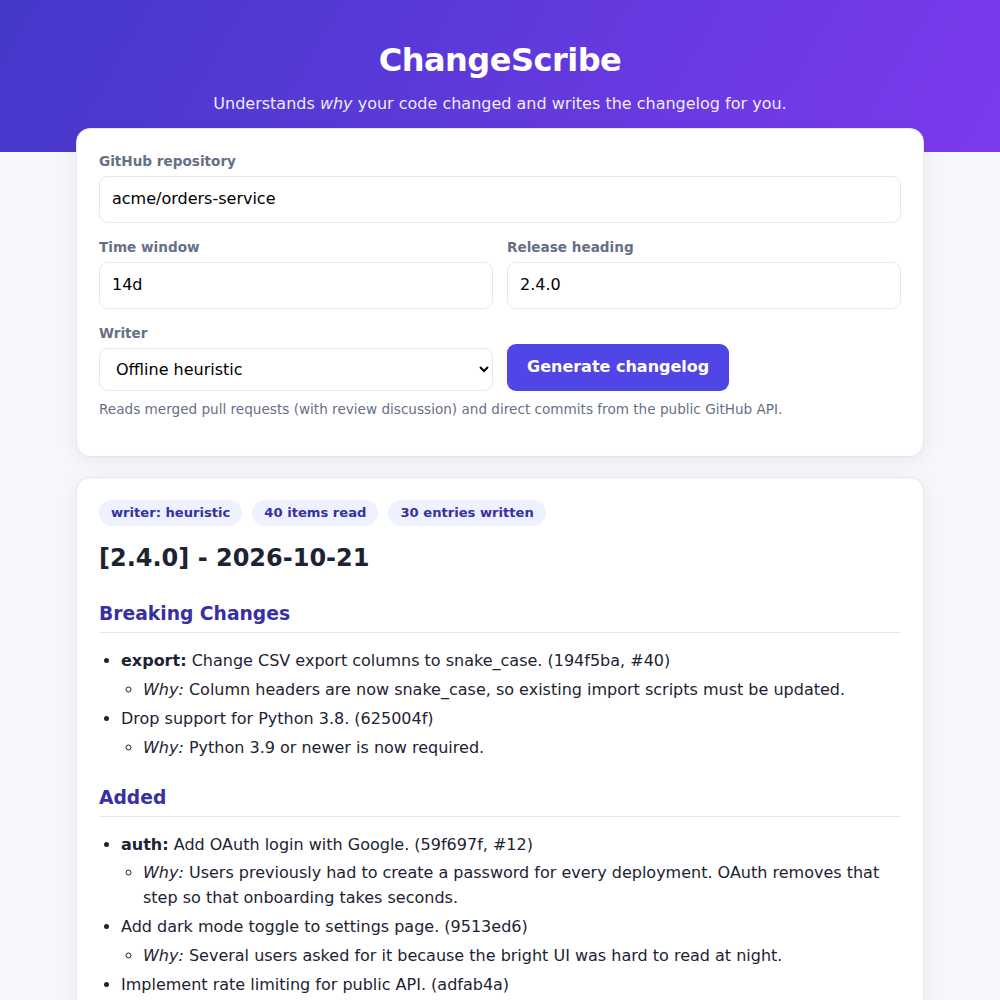

# ChangeScribe

**Automated README & changelog generator from commit and pull-request history.**

Auto-doc tools usually read function signatures and produce lines like `// gets the user`.
ChangeScribe reads the *history* instead: commit messages, merged pull requests and their
review discussion over a sprint. It works out **why** each change was made and writes a
structured, human-readable changelog (and an optional README "Recent changes" block).



*Screenshot generated from the bundled demo repository, not a real GitHub project.*

## How it works

```
GitHub API / local git ──► collector ──► parser ──► summarizer ──► renderer ──► CHANGELOG.md / README.md
 (PRs, comments, commits)   raw Changes   classify,     LLM (or offline   Markdown,
                                          de-noise,     heuristic)        idempotent
                                          extract "why",                  file updates
                                          chunk
```

1. **Collect** – merged PRs (title, description, review + issue comments, changed files) and direct
   commits not covered by a PR, via the GitHub REST API; or `git log --numstat` from a local clone.
2. **Parse** – classify into feature / fix / perf / refactor / docs / test / build / breaking using
   conventional-commit prefixes, PR labels, keywords and file paths; drop noise (merges, WIP, fixups);
   pull out the sentences that explain intent ("because…", "so that…", `BREAKING CHANGE:`); pack into
   token-bounded chunks.
3. **Summarize** – an LLM (Anthropic Messages API) rewrites each change as one plain-English sentence
   plus a *Why* line, using only facts present in the input. If no API key is set, or a call fails,
   a deterministic offline writer is used so the tool never blocks a pipeline.
4. **Render** – Keep-a-Changelog style Markdown; the changelog and README are updated idempotently
   (re-running replaces the same section instead of duplicating it).

## Quick start

```bash
git clone https://github.com/<you>/changescribe.git && cd changescribe
pip install -r requirements.txt

# Local repository (last 14 days), print only
python -m changescribe generate --repo /path/to/repo --since 14d --dry-run

# Remote repository through the GitHub API, write the files
export GITHUB_TOKEN=ghp_...           # optional for public repos, needed for private ones
export ANTHROPIC_API_KEY=sk-ant-...   # optional: enables the LLM writer
python -m changescribe generate --github owner/name --since 2w --release 1.4.0 \
        --changelog CHANGELOG.md --readme README.md
```

Useful flags: `--backend auto|anthropic|heuristic`, `--no-minor` (hide docs/test/build/chore),
`--json` (structured output), `--branch`, `--until`, `--dry-run`.

### Web UI

```bash
python -m changescribe serve --port 5000     # http://localhost:5000
```

### Docker

```bash
docker build -t changescribe .
docker run -p 8000:8000 -e ANTHROPIC_API_KEY -e GITHUB_TOKEN changescribe          # web UI
docker run --rm -v "$PWD:/repo" changescribe generate --repo /repo --dry-run        # CLI
```

### GitHub Action (use it on your own repository)

```yaml
# .github/workflows/changelog.yml
name: Sprint changelog
on:
  schedule: [{ cron: "0 6 * * 1" }]
  workflow_dispatch:
permissions: { contents: write, pull-requests: write }
jobs:
  changelog:
    runs-on: ubuntu-latest
    steps:
      - uses: actions/checkout@v4
        with: { fetch-depth: 0 }
      - uses: <you>/changescribe@v1
        with:
          since: 14d
          changelog: CHANGELOG.md
          readme: README.md
          anthropic-api-key: ${{ secrets.ANTHROPIC_API_KEY }}
      - uses: peter-evans/create-pull-request@v6
        with: { title: "docs: sprint changelog update", branch: changescribe/changelog }
```

`.github/workflows/docs.yml` in this repo is the same idea applied to ChangeScribe itself.

### Deploy the web UI

* **Render** – push to GitHub, "New → Blueprint", pick the repo (`render.yaml` is included).
* **Railway / Heroku / Fly** – `Procfile` runs `gunicorn changescribe.webapp:app`.
* Set `ANTHROPIC_API_KEY` and `GITHUB_TOKEN` as environment variables; `/healthz` is the health check.

## Example output

Generated from the bundled demo sprint (`python scripts/make_demo_repo.py demo_repo`):

```markdown
### Fixed
- **api:** Handle empty payload in /orders. (28a5c39, #31)
  - *Why:* The endpoint crashed with a 500 because the JSON body was None.
- Resolve race condition in session cleanup job. (67dc224)
  - *Why:* Two workers could delete the same session because there was no lock.

### Performance
- **db:** Add index on orders.created_at. (2e3bad0)
  - *Why:* Dashboard queries were scanning the whole table which caused 4s page loads.
```

Full sample: [`docs/assets/sample_output.md`](docs/assets/sample_output.md).

## Evaluation

`python scripts/evaluate.py` runs the offline writer on a labelled 40-commit demo sprint:

| Metric | Result |
|---|---|
| Noise commits removed (precision / recall) | 1.00 / 1.00 |
| Category accuracy (30 real changes) | 86.7 % (conventional 100 %, free-form 80 %) |
| Macro F1 over categories | 0.95 |
| Changes whose rationale was captured | 100 % (0 false positives) |
| Pipeline time (local) | ≈ 7 ms |

The demo set is small, synthetic and was used while tuning the rules, so treat these numbers as a
regression baseline rather than a benchmark. The LLM writer is covered by mocked-API tests; its
quality on real repositories should be checked on your own history.

## Project layout

```
changescribe/
  collector.py   GitHub REST + local git collection
  parser.py      classification, noise filter, rationale extraction, chunking
  summarizer.py  Anthropic LLM writer + offline heuristic writer
  renderer.py    Markdown rendering, CHANGELOG / README updaters
  pipeline.py    orchestration     cli.py  command line     webapp.py  Flask UI
scripts/         make_demo_repo.py, evaluate.py
tests/           24 unit / integration tests (no network required)
```

## Testing

```bash
pip install -r requirements-dev.txt
python -m pytest -q          # or: python -m unittest discover -s tests
```

## Design notes and limits

* No model is trained; the work is the data pipeline and prompt contract. The prompt forbids inventing
  facts and the parser only passes rationale sentences that exist in the history.
* Quality depends on the source text. Repositories with empty commit bodies and no PR discussion get
  accurate but terse entries.
* Only commit/PR text and file *names* are sent to the LLM, never full source files or diffs.
* Large histories are chunked (≈6 000 characters per request) and API failures degrade gracefully.

## License

MIT

<!-- changescribe:start -->
## Recent changes

This period: 1 added, 1 documentation.

## [Unreleased] - 2026-10-26

### Added

- Initial release of ChangeScribe. ([146ae0c](https://github.com/Ksinghania2/ChangeScribe--Automated-README-changelog-generator-from-commit-and-pull-request-history/commit/146ae0c2f5ad9fa5261dfe0112eab8d1a8cd9111))

### Documentation

- Add report builder, diagrams and evaluation assets. ([09a597c](https://github.com/Ksinghania2/ChangeScribe--Automated-README-changelog-generator-from-commit-and-pull-request-history/commit/09a597c692974dc793890d1a8cb59b3c15bde95e))
<!-- changescribe:end -->
